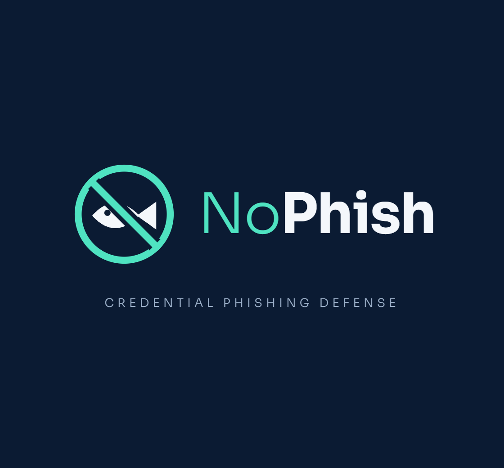

# NoPhish



NoPhish is a local phishing-detection prototype for Chrome on Windows. It checks
saved domain decisions first, then uses a local vision-language model to identify
supported brands' login forms and compare them with the page's hostname.

**Screenshot + URL -> SQLite domain lists -> Ollama login/brand classification -> exact hostname verification -> browser warning**

The current model is **`qwen3.5:0.8b`**, served by Ollama on the NVIDIA GPU.
There is no OCR stage: EasyOCR, RapidOCR, PyTorch and ONNX Runtime are no longer
Python dependencies. Model installation is handled separately by the user.

## How detection works

1. The extension captures the **visible viewport**, not the entire scrollable
   page, and sends its PNG screenshot and URL to `127.0.0.1:8000`.
2. The server checks the normalized hostname in SQLite before image decoding or
   inference. Whitelisted hosts immediately return `safe`; blacklisted hosts
   immediately return `dangerous`.
3. For an unlisted host, the server sends the screenshot to local Ollama. The
   image fits within **1280 x 1280 pixels**, preserving aspect ratio without
   upscaling. A recent 2560 x 1271 capture therefore becomes 1280 x 636.
4. The model is instructed to return a label such as `microsoft_login` or
   `google_login` for a supported brand's visible authentication form. Non-login
   pages, unsupported brands and uncertain classifications all share `unknown`.
5. Supported labels are converted to base brand names, such as `microsoft`, for
   exact hostname verification. A supported brand login on an unapproved host
   produces a warning. A brand prediction alone is not a danger verdict.

The prompt asks the model to ignore instructions embedded in screenshots, logos
without forms, navigation login links and secondary social sign-in buttons.
These instructions reduce ambiguity but do not guarantee correct classification.

| Result | Meaning | Extension display |
| --- | --- | --- |
| `dangerous` | Blacklisted hostname, or supported brand login on an unapproved host | Red `!` and dismissible warning |
| `safe` | Whitelisted hostname, or supported brand login on an approved host | No warning |
| `unknown` | No supported brand login detected, uncertainty, or analysis failure | `?` badge; no danger warning |

`unknown` is inconclusive, not verified safe. The current server does not emit a
separate `not_login` result. NoPhish warns; it does not block navigation.

## Requirements and setup

- Windows with Chrome and **Python 3.11**.
- An NVIDIA GPU with enough VRAM for the selected model. Development and the
  recorded evaluation used an RTX 3080 Ti Laptop GPU with 16 GB VRAM.
- [Ollama for Windows](https://docs.ollama.com/windows), running locally with
  **`qwen3.5:0.8b` already installed**.
- Node.js only if you want to run the extension's JavaScript tests.

Run these commands in the repository root:

```powershell
py -3.11 -m venv .venv
.\.venv\Scripts\python.exe -m pip install -r requirements-dev.txt
.\.venv\Scripts\python.exe -m pip check
```

If you use `uv`:

```powershell
uv venv --python 3.11
uv pip install --link-mode copy --python .venv\Scripts\python.exe -r requirements-dev.txt
uv pip check --python .venv\Scripts\python.exe
```

Use `requirements.txt` instead for runtime dependencies only. The development
requirements currently include the same runtime packages. Old OCR packages and
`.models` caches are unused; no OCR weights or CUDA-enabled Python packages need
to be installed.

The model is selected by `MODEL_ID` in [server/classifier.py](server/classifier.py).
To change it, install a compatible vision model separately, update that constant,
and restart NoPhish. Selecting a different model in Ollama alone does not change
NoPhish's requests. NoPhish never downloads a model automatically.

## Start the server

For a visible console:

```powershell
.\.venv\Scripts\python.exe -m uvicorn server.main:app --host 127.0.0.1 --port 8000 --no-access-log
```

Wait for `Ollama ready: local login/brand model fully GPU-resident`.
Use one worker. GPU requests are serialized with a lock and run outside the
server's event loop. If Ollama/model setup fails, unlisted analyses return
`unknown`; saved domain decisions still work in the running server.

### Hidden Windows startup

Double-click [start_nophish.vbs](start_nophish.vbs) to launch without a console.
It runs [startup.pyw](startup.pyw) with this project's virtual environment,
prevents duplicate launcher instances, and exits if port 8000 is already in use.
It can start an installed `ollama serve` in the background and waits up to
60 seconds for Ollama. It does not install dependencies or download models.
If Ollama never becomes available, the hidden launcher exits and logs the issue.

To start automatically when you sign in to Windows:

1. Press **Win+R**, enter `shell:startup`, and press Enter.
2. Create a shortcut in that folder pointing to this project's `start_nophish.vbs`.
3. Leave the actual launcher in the repository. Update the shortcut if you move it.

Diagnostics are written to `.data/startup.log`, rotated at 1 MB with two backups.
Remove the shortcut to disable automatic startup. Closing Chrome does not stop
NoPhish or Ollama.

### Restart a hidden server

In Task Manager, open **Details**, enable the **Command line** column, and end the
Python process whose command line contains this project's full `startup.pyw`
path. It may be named `python.exe` or `pythonw.exe`. Then double-click
`start_nophish.vbs` again. For a manual console server, press **Ctrl+C** and rerun
the console command. Avoid running a console server alongside the hidden one.

## Load and use the extension

1. Open `chrome://extensions` and enable **Developer mode**.
2. Choose **Load unpacked**, select the [extension](extension) folder, and pin NoPhish.
3. Browse normally, or click the toolbar icon and choose **Inspect page** to retry.

Reload the extension and affected tabs after extension code updates. Server-only
changes require a server restart, not an extension reload.

The extension uses a Manifest V3 service worker, `webNavigation`, and
`<all_urls>` access for visible-tab capture. Content scripts run on HTTP(S) pages.
Load, activation, navigation, SPA route changes and newly visible password fields
can trigger debounced inspection; a password field is not a prerequisite.
Duplicate events coalesce and stale results are discarded. There is no continuous
screenshot polling. Capture throttling, debounce and queueing add time before a
request; the local request timeout is 10 seconds. Offline and request errors
appear as `OFF` and `ERR`; **Inspect page** provides a manual retry.

### Domain lists and warnings

Click the toolbar icon to:

- Whitelist, blacklist or remove the current hostname.
- Add another hostname or HTTP(S) URL manually.
- View and remove saved entries.
- Open the full manager in the extension's options page.

Unsupported pages such as `chrome://extensions` disable current-page actions;
manual domain management remains available. Saving the opposite decision replaces
the previous entry. Removing an entry restores normal model analysis. Changes
apply immediately, without restarting the server.

Danger warnings explain whether the hostname is blacklisted or the page appears
to impersonate a named brand. **Trust domain - whitelist** and **Confirm danger -
blacklist** save your decision. Model predictions never populate either list
automatically. Dismissing a notice leaves the danger badge in place; whitelisting
clears it.

Entries persist in `.data/domains.sqlite3`. The 40 primary domains in
[extension/brands.json](extension/brands.json) are seeded into the whitelist once
per database. Later removals and blacklist decisions persist across restarts.
Matching is exact: `example.com` does not cover `www.example.com`, other
subdomains or `example.com.attacker.invalid`. A whitelist entry explicitly skips
analysis; it does not establish that a site is harmless.

### Alert timer

Danger alerts display **Response time: ... ms**. The timer starts immediately
before the screenshot POST and ends after the complete JSON response has been
received and decoded. It includes server processing and local request/response
overhead, excluding capture, payload encoding, debounce and rendering. A warning
refreshed directly from a saved decision has no new screenshot request and shows
no fabricated timing.

## Supported brands and hostname policy

[extension/brands.json](extension/brands.json) is the shared registry for prompt
labels, approved hostnames, initial whitelist entries and extension validation.
It covers the 40 requested account, shopping, social, UK banking, government,
delivery and AI brands, plus a legacy `meta` label for WhatsApp compatibility.
Gemini, Copilot, Meta AI, Facebook and Instagram have separate labels from their
parent companies. ChatGPT/OpenAI maps to `openai`, Claude/Anthropic to
`anthropic`, and X/Twitter to `twitter`.

All approved hosts are explicit. There are no inferred `www`, regional, tenant,
SSO or other subdomain exceptions. The primary domains are not a comprehensive
list of every legitimate login host. The parser normalizes case, a trailing
root dot and IDNA/UTS #46 names; it compares parsed hostnames rather than URL
substrings. Paths, queries, ports and HTTPS alone do not establish trust.
Explicit user-list decisions take precedence over model/domain checks.

## Local API and data handling

The server listens on **`http://127.0.0.1:8000`**. The extension sends analysis
requests from its background worker; CORS is not enabled.

| Endpoint | Purpose |
| --- | --- |
| `POST /analyze` | JSON with `url` and a PNG/JPEG base64 data URL in `screenshot`; returns `verdict`, `brand` and `reason` |
| `GET /domain-policies` | List saved hostname decisions |
| `PUT /domain-policies` | Save `{"domain":"example.com","policy":"whitelist"}` or `blacklist` |
| `DELETE /domain-policies` | Remove `{"domain":"example.com"}` |

List writes require `Content-Type: application/json` and
`X-NoPhish-Action: domain-policy`; ordinary website origins are rejected.
User-list results also include `source: user_list` and `brand: null`.
Database errors return `unknown` without inference.

Only screenshot images and the fixed prompt go to Ollama at `127.0.0.1:11434`;
the page URL is used by the Python server for domain checks. The server uses
`/api/generate` for preloading, `/api/chat` for inference and `/api/ps` to verify
full GPU residency. CPU/partial offload is rejected. Requests ignore HTTP proxy
environment settings and do not follow redirects.

The model stays loaded with `keep_alive: -1`. Inference uses `temperature: 0`,
`think: false`, `stream: false` and `num_predict: 16`. Startup preload has a
60-second timeout; classification has an 8-second timeout.

Runtime screenshots, URLs and raw model text are not saved or logged. The
extension does not read form input values. SQLite stores normalized hostnames,
decisions and a seed marker; logs contain limited status, label and timing data.
Images are processed in memory. Limits are 8 MiB per request, 6 MiB per image,
and 20 million decoded pixels. Dependency/model installation needs internet;
inference has no cloud dependency.

## Tests and current evaluation

```powershell
.\.venv\Scripts\python.exe -m unittest discover -s tests -p "test_*.py" -v
node --test tests/extension.test.cjs tests/content.test.cjs tests/options.test.cjs tests/popup.test.cjs
.\.venv\Scripts\python.exe -m server.classifier --check-samples
.\.venv\Scripts\python.exe tests/evaluate.py
```

The current backend passes **41 Python tests**. Unit tests mock Ollama responses
and cover strict login labels, shared `unknown`, request/image validation, model
failure, GPU placement, hostname verification, domain-list bypass and startup.
The real Ollama smoke check passes **9 scenarios across 6 public images**.

The evaluation commands require the installed model and running Ollama. They
bypass saved domain decisions so approved hosts still exercise the model.
[tests/evaluate.py](tests/evaluate.py) runs three rounds and writes labels,
call counts and timings to
[tests/vlm-only-evaluation-results.json](tests/vlm-only-evaluation-results.json).
The branded article probes are generated in memory; user captures are never used.

Recorded on **4 November 2026**, with `qwen3.5:0.8b`:

| Measure | Result |
| --- | --- |
| Images / URL scenarios | 13 / 16 |
| Correct first-round verdicts | 15 / 16 |
| Supported login brands identified | 3 / 3 |
| False warnings in benign scenarios | 1 / 13 |
| Label changes across repeat rounds | 0 |
| Warm endpoint median / p95 | 244 ms / 724 ms |

Warm timings use 32 requests after excluding the first round. They include
in-process API handling, Ollama HTTP, preprocessing, inference and GPU-placement
checks, excluding browser capture, debounce and browser/server socket transport.
Repeated identical screenshots can benefit from Ollama caching. These small
fixture measurements do not predict normal browsing latency or establish
independent detection accuracy.

The known failure is a synthetic Google article with a **Sign in** navigation
link but no authentication form: the model labels it `google_login`, producing
a false warning on an unapproved hostname. The corresponding synthetic Microsoft
article returns `unknown`. Only Microsoft, Google and Facebook have real branded
login fixtures in this set; registry support does not establish measured accuracy
for all brands. See [fixture details](tests/samples/README.md).

For a manual extension demo:

```powershell
.\.venv\Scripts\python.exe -m http.server 8001 --bind 127.0.0.1 --directory tests
```

Open `http://127.0.0.1:8001/demo.html?view=account`. The Microsoft login image on
localhost should warn; the news view should return `unknown`. Try navigation,
Back/Forward, dismissing the warning, list edits and **Inspect page**. Avoid
whitelisting localhost if you want the demo to exercise model inference.

Older OCR/Transformers benchmark JSON files remain as historical artifacts.
Their stages, datasets and timings are not the current pipeline.

## Limitations

This is a prototype. The VLM can mistake branded content for a login, miss real
forms, misidentify a brand or follow instructions embedded in an image. The
shared `unknown` label does not distinguish ordinary pages from unsupported
logins or failures. Every unlisted screenshot reaches the VLM.

Only the visible viewport is analyzed. Same-URL changes without a newly visible
password field may need a manual retry. The explicit hostname map can omit
legitimate login hosts and cause false warnings. A page can remove an injected
notice; the browser-owned badge is separate. Native installation and real
capture/navigation should be checked with the manual demo. No result guarantees
that a website is harmless.

The original milestones in [plan.md](plan.md) retain historical context; its
current implementation note supersedes the removed OCR requirements.
